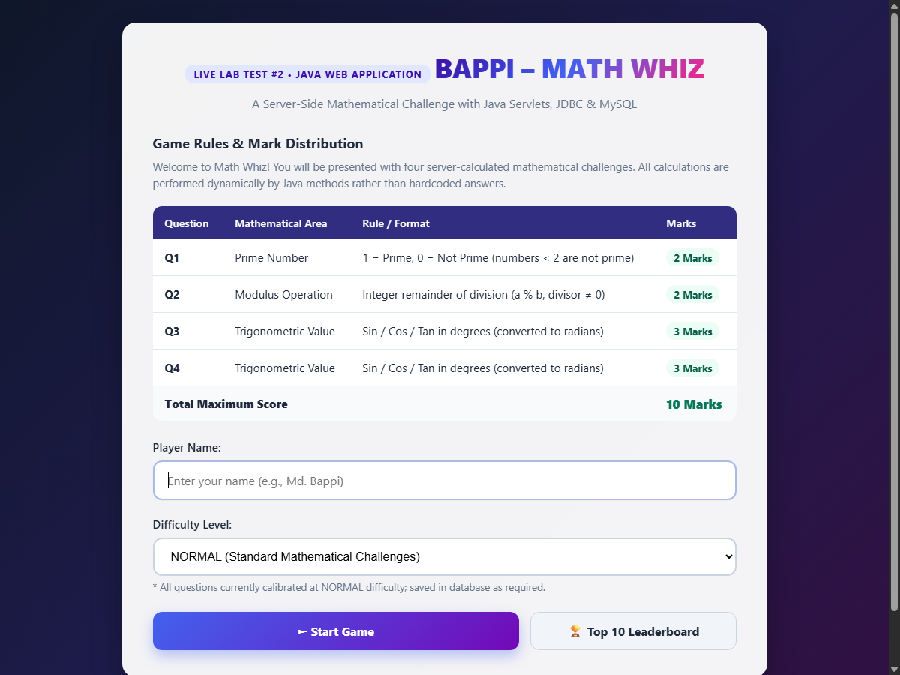
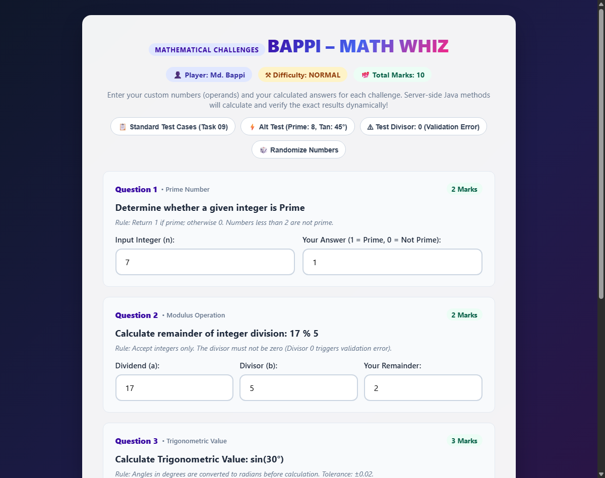
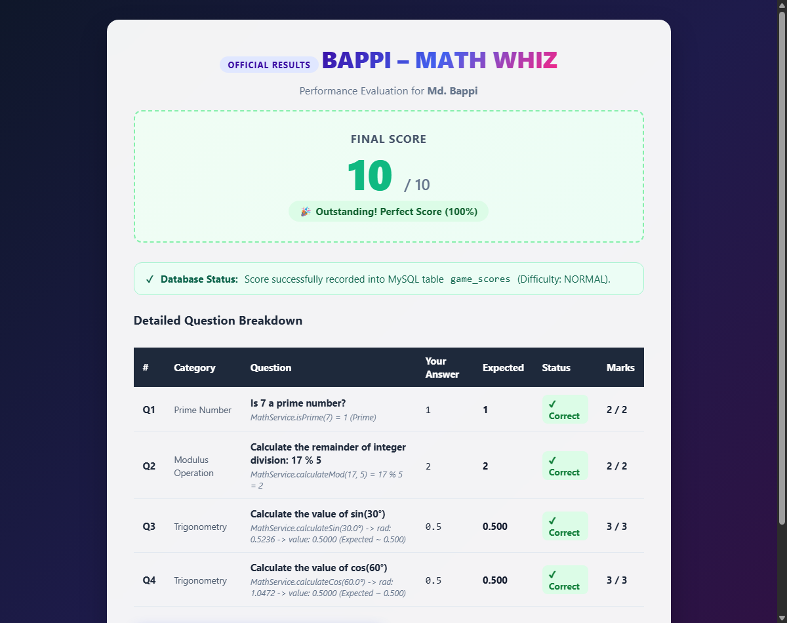
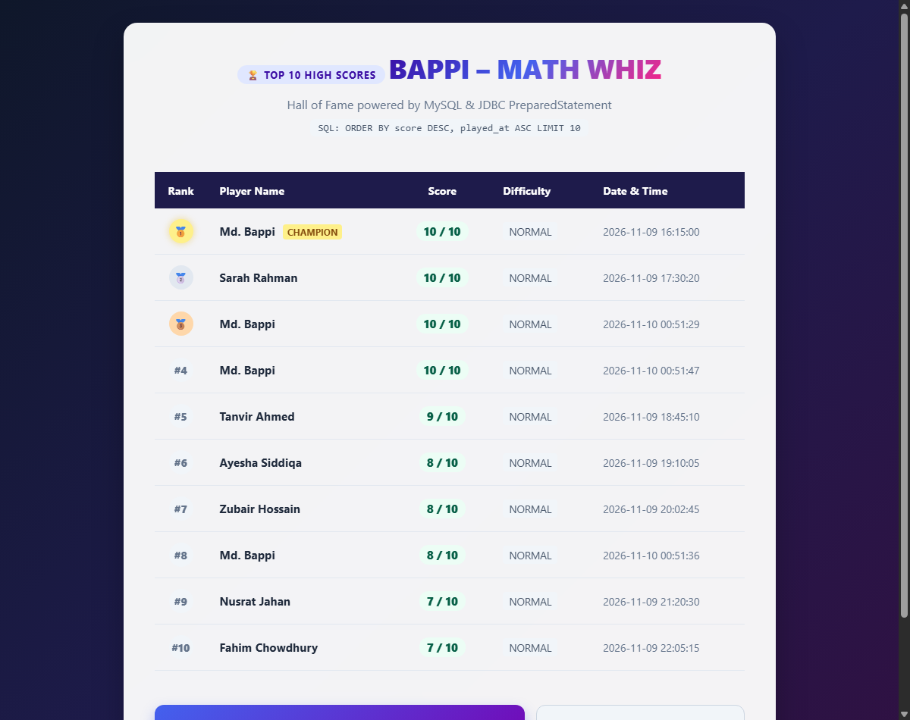

# BAPPI – MATH WHIZ 🎮📐
### Java Web Application Development — Live Lab Test #2
**Practical Lab Practice: Java Servlet, JDBC & MySQL**  
**Author:** Md. Bappi (mbstu.ac.bd)  
**GitHub Repository Link:** [https://github.com/Bappi003/Bappi-_Whiz_Game](https://github.com/Bappi003/Bappi-_Whiz_Game)

---

## 01. Project Overview & Objectives
**BAPPI – MATH WHIZ** is a web-based mathematical game developed with Java Servlets, JSP, JDBC, and MySQL. It presents four server-side calculated mathematical challenges covering **Prime Numbers**, **Modulus Operations**, and **Trigonometry**.

### Core Objectives:
1. **Reusable Java Methods:** Calculate all mathematical solutions dynamically using clean, modular server-side Java methods rather than static/hardcoded answers.
2. **Server-Side Request Processing:** Handle game sessions, dynamic challenge generation, validation, and evaluation using `jakarta.servlet` (Tomcat 10+).
3. **Database Connectivity (JDBC):** Establish secure database operations using `PreparedStatement` to persist player records and query the top 10 leaderboard sorted by score and timestamp.
4. **Interactive Glassmorphism UI:** Provide an engaging, modern, responsive user experience with real-time feedback, detailed step-by-step calculation breakdowns, and ranked leaderboard medals.

---

## 02. Game Rules & Mark Distribution

| Question | Mathematical Area | Evaluation & Rules | Marks |
| :---: | :--- | :--- | :---: |
| **Q1** | **Prime Number** | Return `1` if prime; otherwise `0`. Numbers $< 2$ are not prime. | **2 Marks** |
| **Q2** | **Modulus Operation** | Calculate integer remainder using `%` (`a % b`). Divisor must not be zero. | **2 Marks** |
| **Q3** | **Trigonometric Value** | Calculate $\sin(\theta)$, $\cos(\theta)$, or $\tan(\theta)$ from degree input converted to radians. | **3 Marks** |
| **Q4** | **Trigonometric Value** | Calculate $\sin(\theta)$, $\cos(\theta)$, or $\tan(\theta)$ from degree input converted to radians. | **3 Marks** |
| **Total** | — | **Maximum Possible Score** | **10 Marks** |

### Mathematical Specifications:
- **Prime Function:** `public static int isPrime(int number)`  
  Evaluates prime status using $O(\sqrt{n})$ trial division. Numbers $< 2$ return `0`.
- **Modulus Function:** `public static int calculateMod(int a, int b)`  
  Computes remainder `a % b`. Throws `ArithmeticException` if $b = 0$.
- **Trigonometric Functions:**  
  `public static double calculateSin(double degree)`  
  `public static double calculateCos(double degree)`  
  `public static double calculateTan(double degree)`  
  Angles in degrees are converted to radians via `Math.toRadians(degree)`. Undefined tangent values (e.g. $90^\circ, 270^\circ$) throw `ArithmeticException`. Decimal answers are evaluated within a tolerance of $\pm 0.02$.  
  *Mathematical Reference:* $x^2 + y^2 = 1$ ($\sin^2\theta + \cos^2\theta = 1$).
- **Difficulty Level:** `NORMAL` (stored in database for every game session).

---

## 03. Project Architecture & Structure

The project follows the standard **MVC (Model-View-Controller)** pattern with DAO data persistence:

```
MathWhiz/
├── pom.xml                                    # Maven dependencies & build configuration
├── database/
│   └── math_whiz_db.sql                       # Database schema and seed data
├── screenshots/
│   ├── home.png                               # Screen 1: Welcome Page
│   ├── game.png                               # Screen 2: Game Page
│   ├── result.png                             # Screen 3: Result Page
│   └── leaderboard.png                        # Screen 4: Top 10 Leaderboard
├── src/
│   ├── main/
│   │   ├── java/com/mathwhiz/
│   │   │   ├── controller/
│   │   │   │   └── GameServlet.java           # Servlet request router & session controller
│   │   │   ├── model/
│   │   │   │   ├── GameScore.java             # Score model entity
│   │   │   │   └── QuestionItem.java          # Question challenge entity
│   │   │   ├── service/
│   │   │   │   └── MathService.java           # Independent mathematical logic & questions generator
│   │   │   └── dao/
│   │   │       ├── DBUtil.java                # JDBC connection provider with auto-fallback
│   │   │       └── ScoreDAO.java              # PreparedStatement CRUD for game_scores
│   │   ├── resources/
│   │   │   └── db.properties                  # Database configuration properties
│   │   └── webapp/
│   │       ├── WEB-INF/
│   │       │   └── web.xml                    # Web application deployment descriptor
│   │       ├── css/
│   │       │   └── style.css                  # Modern responsive stylesheet
│   │       ├── index.jsp                      # Welcome & player entry page
│   │       ├── game.jsp                       # 4-question challenge page
│   │       ├── result.jsp                     # Score & breakdown report page
│   │       └── leaderboard.jsp                # Top 10 high-scores page
│   └── test/
│       └── java/com/mathwhiz/service/
│           └── MathServiceTest.java           # JUnit 4 test suite (22 unit tests)
└── README.md                                  # Complete project documentation
```

---

## 04. Technologies Used & Software Requirements

- **Programming Language:** Java 21 (LTS) / Java 17+
- **Server Framework:** Jakarta Servlet API 6.0 (Tomcat 10.1+)
- **Presentation Layer:** JSP (JavaServer Pages), HTML5, CSS3 Glassmorphism
- **Build & Dependency Tool:** Apache Maven 3.9+
- **Database:** MySQL 8.0 / MariaDB (XAMPP)
- **Database Driver:** `mysql-connector-j` 8.4.0
- **Testing Framework:** JUnit 4.13.2 (22 passing unit tests)
- **Version Control:** Git & GitHub

---

## 05. Database Configuration & Schema (JDBC)

### Database: `math_whiz_db`
### Table: `game_scores`

| Field | Data Type | Key / Constraint | Description |
| :--- | :--- | :--- | :--- |
| `id` | `INT` | Primary Key, Auto Increment | Unique record identifier |
| `player_name` | `VARCHAR(100)` | NOT NULL | Player's display name |
| `score` | `INT` | NOT NULL | Final score out of 10 |
| `difficulty` | `VARCHAR(20)` | NOT NULL DEFAULT `'NORMAL'` | Difficulty level |
| `played_at` | `TIMESTAMP` | DEFAULT `CURRENT_TIMESTAMP` | Date and time played |

### Database Creation SQL (`database/math_whiz_db.sql`):
```sql
CREATE DATABASE IF NOT EXISTS math_whiz_db;
USE math_whiz_db;

CREATE TABLE IF NOT EXISTS game_scores (
    id INT AUTO_INCREMENT PRIMARY KEY,
    player_name VARCHAR(100) NOT NULL,
    score INT NOT NULL,
    difficulty VARCHAR(20) NOT NULL DEFAULT 'NORMAL',
    played_at TIMESTAMP DEFAULT CURRENT_TIMESTAMP
) ENGINE=InnoDB DEFAULT CHARSET=utf8mb4;
```

### Top 10 Leaderboard SQL Query:
```sql
SELECT id, player_name, score, difficulty, played_at
FROM game_scores
ORDER BY score DESC, played_at ASC
LIMIT 10;
```

---

## 06. Steps to Run the Application

### Option A: Running with Apache Tomcat 10.1
1. **Clone or Download the Repository:**
   ```bash
   git clone https://github.com/Bappi003/Bappi-_Whiz_Game.git
   cd Bappi-_Whiz_Game
   ```
2. **Build the WAR File with Maven:**
   ```bash
   mvn clean package
   ```
   *Output file:* `target/MathWhiz.war`
3. **Deploy to Tomcat:**
   Copy `target/MathWhiz.war` into your Tomcat `webapps/` folder:
   ```bash
   cp target/MathWhiz.war $CATALINA_HOME/webapps/
   ```
4. **Start Apache Tomcat:**
   - **Windows:** `%CATALINA_HOME%\bin\startup.bat`
   - **Linux/macOS:** `$CATALINA_HOME/bin/startup.sh`
5. **Open in Browser:**
   Navigate to: [http://localhost:8080/MathWhiz/](http://localhost:8080/MathWhiz/)

---

### Option B: Running in IntelliJ IDEA
1. Open IntelliJ IDEA.
2. Select **File -> Open...** and choose `MathWhiz/pom.xml`.
3. Configure a **Tomcat Server (Local)** Run Configuration:
   - Server: Apache Tomcat 10.1
   - Deployment: `MathWhiz:war` or `MathWhiz:war exploded`
   - Application context: `/MathWhiz`
4. Click **Run (Shift + F10)**.

---

### Running Automated Unit Tests
To verify all mathematical algorithms, zero-division handling, and score distribution:
```bash
mvn test
```
*Expected Result:*
```
[INFO] Running com.mathwhiz.service.MathServiceTest
[INFO] Tests run: 22, Failures: 0, Errors: 0, Skipped: 0
[INFO] BUILD SUCCESS
```

---

## 07. Test Cases & Validation Summary

| Test Case | Method Call / Input | Expected Result | Actual Result | Status |
| :--- | :--- | :---: | :---: | :---: |
| Prime check: 7 | `MathService.isPrime(7)` | `1` (Prime) | `1` | Passed |
| Prime check: 8 | `MathService.isPrime(8)` | `0` (Not Prime) | `0` | Passed |
| Prime check: 1 | `MathService.isPrime(1)` | `0` (Not Prime, $< 2$) | `0` | Passed |
| Modulus: 17 % 5 | `MathService.calculateMod(17, 5)` | `2` | `2` | Passed |
| Modulus: Divisor 0 | `MathService.calculateMod(10, 0)` | `ArithmeticException` | Thrown & Handled | Passed |
| Sine: 30° | `MathService.calculateSin(30.0)` | `0.5` | `0.5000` | Passed |
| Cosine: 60° | `MathService.calculateCos(60.0)` | `0.5` | `0.5000` | Passed |
| Tangent: 45° | `MathService.calculateTan(45.0)` | `1.0` | `1.0000` | Passed |
| Tangent: 90° | `MathService.calculateTan(90.0)` | `ArithmeticException` | Thrown & Handled | Passed |
| All Answers Correct | Q1 + Q2 + Q3 + Q4 | 2 + 2 + 3 + 3 = **10 Marks** | **10 Marks** | Passed |
| Incorrect Answers | Wrong inputs | Corresponding 0 marks | 0 Marks awarded | Passed |

---

## 08. Application Screenshots

### Welcome Page (`index.jsp`)
*Player enters name, selects difficulty, reviews rules and marks table.*


### Game Page (`game.jsp`)
*Player completes the 4 mathematical challenges computed dynamically by Java.*


### Result Page (`result.jsp`)
*Final score display (out of 10), performance badge, database confirmation, and step-by-step breakdown.*


### Top 10 Leaderboard (`leaderboard.jsp`)
*Top 10 scores retrieved from MySQL via JDBC, sorted by `score DESC, played_at ASC`.*


---

## 09. Submission Information
- **Course:** Java Web Application Development
- **Assignment:** Live Lab Test #2
- **Developer:** Md. Bappi
- **Institution:** Mawlana Bhashani Science and Technology University (MBSTU)
- **Submission Repository URL:** [https://github.com/Bappi003/Bappi-_Whiz_Game](https://github.com/Bappi003/Bappi-_Whiz_Game)
